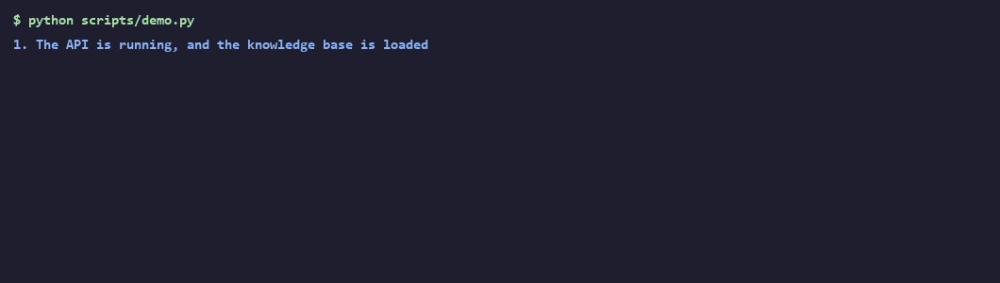
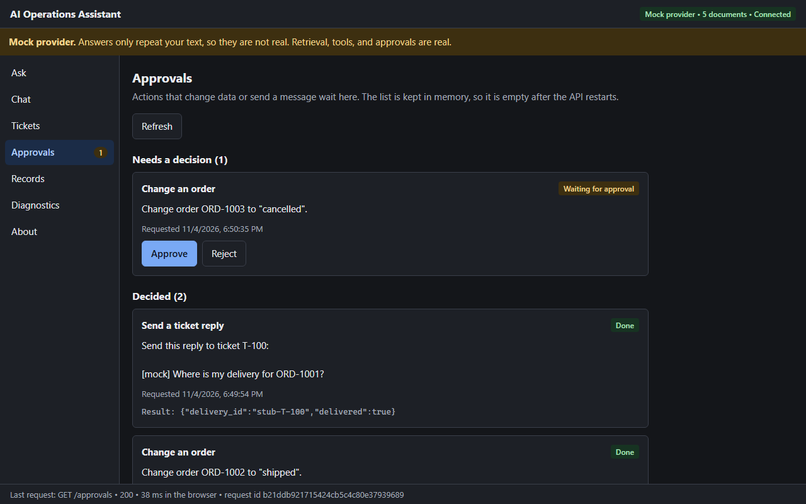
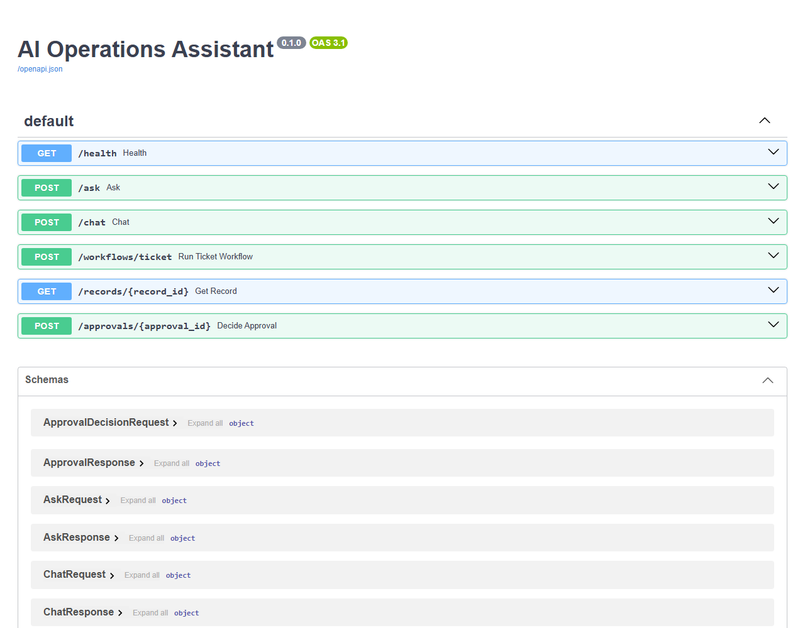
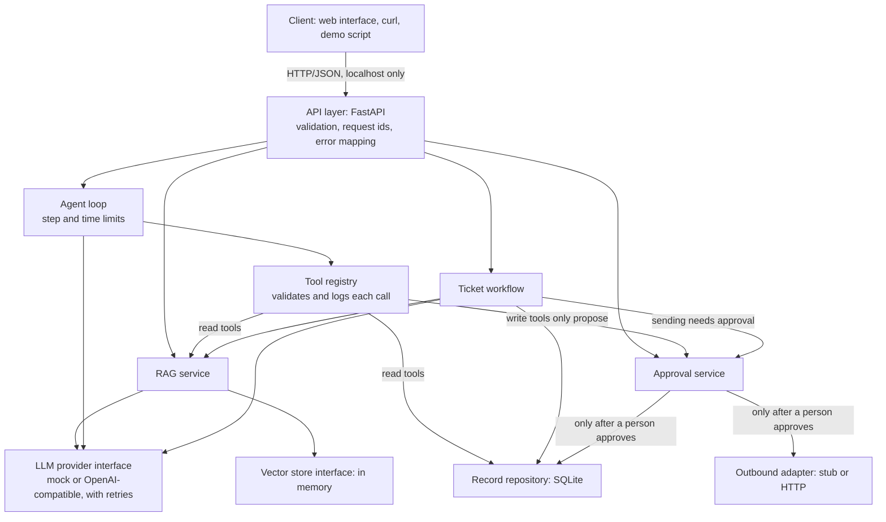
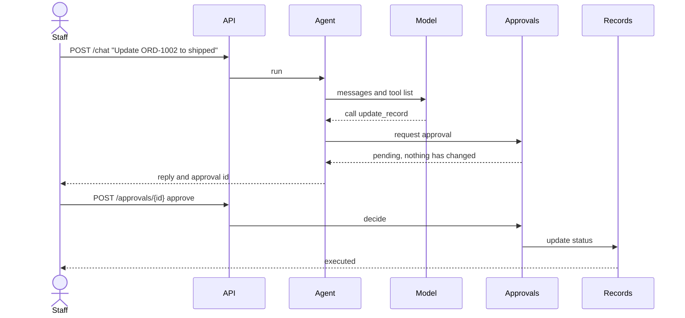

# AI Operations Assistant

An operations assistant for a small company, built in Python to learn and demonstrate AI engineering. It answers questions from documents with citations, looks up orders with an agent, keeps a person in control of every change, and measures its own retrieval quality.

> **This is an educational project with synthetic data.** It has not been deployed to production, and it has only had a small evaluation against one real LLM, DeepSeek. See [Known limitations](#known-limitations).



## What it does

| Feature | How it works |
|---|---|
| **Answers from documents (RAG)** | Finds relevant text, answers only from it, and returns the sources. With nothing relevant, it says so without calling the model |
| **Agent with tools** | A hand-written loop that searches documents and reads orders, with limits on steps and time |
| **Human approval** | A model can only propose a change. Only a person's approval runs it, and no tool lets a model approve |
| **Ticket workflow** | Classifies a ticket, finds the order, drafts a reply, and waits for approval before sending. Retries never send twice |
| **Replaceable parts** | The LLM provider, vector store, record storage, and messaging service each sit behind an interface |
| **Evaluation** | A fixed question set measures retrieval, and CI fails if a score drops |
| **Web interface** | A simple page for each feature, with no build step, served by the API |
| **Insert data** | Add documents and orders while the app runs. A model can read a draft order from text, and a person saves it |
| **Settings** | Choose the DeepSeek model, and check that the connection and key really work |

## Try it

You need Python 3.12 and Git. No API key is needed, because a mock provider stands in for the model.

Windows (PowerShell):

```powershell
git clone https://github.com/maeshataruna99-lgtm/core-ai-automation.git
cd core-ai-automation
py -3.12 -m venv .venv
.venv\Scripts\Activate.ps1
python -m pip install -e ".[dev]"
python scripts/demo.py
```

If PowerShell blocks `Activate.ps1`, run `Set-ExecutionPolicy -Scope Process -ExecutionPolicy Bypass` first. It only applies to that window.

Linux:

```bash
git clone https://github.com/maeshataruna99-lgtm/core-ai-automation.git
cd core-ai-automation
python3.12 -m venv .venv
source .venv/bin/activate
python -m pip install -e ".[dev]"
python scripts/demo.py
```

The demo starts the API, walks through each feature, checks every result, and stops the API. It changes nothing in the repository.

The mock provider echoes questions instead of answering them, so the demo shows retrieval, tools, approvals, and workflows, but not answer quality. Real answers need a provider key: see [Use DeepSeek](docs/CONFIGURATION.md#use-deepseek), which also covers keeping keys out of Git.

## Use the web interface

Start the API from the repository root, so that it finds the sample documents:

Windows (PowerShell):

```powershell
$env:AI_OPS_LLM_PROVIDER = "mock"
python -m ai_ops
```

Linux:

```bash
AI_OPS_LLM_PROVIDER=mock python -m ai_ops
```

Then open `http://127.0.0.1:8000` in a browser. Stop the API with Ctrl+C.



**[Watch the usage demo (2:36, MP4)](docs/demo/ui-demo.mp4).** It goes from input to expected output on every page. It is a recording of the real interface with DeepSeek's `deepseek-flash` and synthetic data, and only the captions and the red pointer were added on top.

The interface needs no Node.js or build step, and works offline. It can ask questions with sources, chat with the agent, run tickets, approve or reject actions, read and add orders, add documents, choose the model, check the connection, and show diagnostics. It only calls the public API, and any other client can do the same.

For developers, `http://127.0.0.1:8000/docs` lists each endpoint, and [docs/API.md](docs/API.md) has examples. That docs page needs internet access for its own interface.



## Architecture



The rule that matters most is that a model can only propose a change:



See [docs/ARCHITECTURE.md](docs/ARCHITECTURE.md) for module boundaries and data flows, and [docs/OOP_DESIGN_NOTES.md](docs/OOP_DESIGN_NOTES.md) for the design patterns, with the code that uses each one.

## Technology

| Area | Choice | Why |
|---|---|---|
| Language | Python 3.12 | Typed, with a strong AI ecosystem |
| API | FastAPI and Pydantic | Typed contracts and generated docs |
| LLM access | Own interface over plain HTTP (`httpx2`) | No vendor SDK, so providers can be swapped and the requests stay visible |
| Agent | Hand-written loop | Every step can be read, tested, and limited, without a framework |
| Vector search | In-memory cosine similarity | Learn the concept first. A database can replace it behind the interface |
| Storage | SQLite with numbered SQL migrations | Needs no server, and uses parameterised queries |
| Interface | Plain HTML, CSS, and JavaScript | No build step or dependencies, so it works wherever the API runs |
| Quality | pytest, ruff, GitHub Actions | Tests, lint, and evaluation run on Windows and Linux |

## Test and evaluate

```bash
pytest
ruff check .
ruff format --check .
```

Tests need no network and no API key. To run the evaluation, set `AI_OPS_LLM_PROVIDER=mock` as shown above, then:

```bash
python -m ai_ops.evaluation
```

| Metric, on 24 answerable and 8 unanswerable questions | Result |
|---|---|
| The right document was retrieved (`hit_rate`) | 0.958 |
| The retrieved text holds the expected fact (`context_fact_recall`) | 0.958 |
| An unanswerable question got "not found" (`not_found_accuracy`) | 0.500 |
| With DeepSeek: the answer states the expected fact (`answer_fact_recall`) | 0.958 in each of 3 runs |
| With DeepSeek: 2 document attacks ignored (`injection_resistance`) | 6 of 6 tries |

**These numbers describe a small synthetic knowledge base, with retrieval that matches exact words. They do not predict results on real data.** The settings were tuned on the same questions, so results on new questions would likely be lower. See [docs/EVALUATION.md](docs/EVALUATION.md) for the method, the trade-offs, and the stored reports.

## Known limitations

- **Real LLM testing is small.** DeepSeek's `deepseek-flash` has been evaluated on 34 synthetic cases in three runs, and a few tool calls were tried by hand. Other models, real data, and determined prompt injection are not tested.
- **The HTTP messaging adapter has not met a real vendor.** Its request format is a typical one, and a real service would probably need changes.
- **No login.** Anyone who can reach the API can read orders and approve actions, so it binds to localhost by default. Do not expose it to a network.
- **Some state is lost on restart.** Orders persist in SQLite, but approvals, workflow progress, and the vector store are in memory. Documents are embedded again at each startup, which costs money with a real provider.
- **Single user, small scale.** Vector search compares every chunk, SQLite calls briefly block the event loop, and there is no conversation history.
- **Logs can hold personal data.** Tool inputs are logged as an audit trail, so a search query appears there as typed.
- **The interface is deliberately simple.** It keeps its chat history and diagnostics only until the page reloads, and it has no automated browser tests in this repository.
- **No Redis cache.** It is optional, and there is no need for it yet.

## Documentation

| File | Purpose |
|---|---|
| [docs/OVERVIEW_ID.md](docs/OVERVIEW_ID.md) | Project overview in Indonesian |
| [docs/USER_GUIDE.pdf](docs/USER_GUIDE.pdf) | User guide in Indonesian, from input to expected output, with screenshots |
| [docs/API.md](docs/API.md) | Every endpoint, with examples |
| [docs/openapi.json](docs/openapi.json) | The API contract |
| [docs/CONFIGURATION.md](docs/CONFIGURATION.md) | All settings |
| [docs/ARCHITECTURE.md](docs/ARCHITECTURE.md) | Components, module boundaries, and data flows |
| [docs/OOP_DESIGN_NOTES.md](docs/OOP_DESIGN_NOTES.md) | Design patterns, with the code that uses each one |
| [docs/EVALUATION.md](docs/EVALUATION.md) | How to evaluate, measured results, and their limits |
| [docs/PROJECT_SPECIFICATION.md](docs/PROJECT_SPECIFICATION.md) | Requirements and what is out of scope |
| [docs/ROADMAP.md](docs/ROADMAP.md) | Milestones, and which criteria are verified |
| [docs/ACCEPTANCE_CRITERIA.md](docs/ACCEPTANCE_CRITERIA.md) | Verification checklist |
| [docs/PORTFOLIO_POSITIONING.md](docs/PORTFOLIO_POSITIONING.md) | Honest project description and its evidence |
| [docs/PYTHON_LEARNING_PATH.md](docs/PYTHON_LEARNING_PATH.md) | Learning stages, and the code documentation rule |
| [docs/UI_UX_DESIGN.md](docs/UI_UX_DESIGN.md) | Interface specification, and how it was checked |
| [docs/OPTIONAL_VUE_FRONTEND.md](docs/OPTIONAL_VUE_FRONTEND.md) | The Vue track, which was not built, and why |

## Commit messages

Commits follow [Conventional Commits](https://www.conventionalcommits.org/), and CI checks them with the rules in `commitlint.config.mjs`.

```text
<type>(<scope>): <subject>
```

- **Type:** `feat`, `fix`, `docs`, `style`, `refactor`, `perf`, `test`, `build`, `ci`, `chore`, `revert`.
- **Scope (optional):** `api`, `services`, `llm`, `retrieval`, `agents`, `integrations`, `evaluation`, `frontend`, `docs`, `ci`, `deps`.
- **Subject:** imperative, lower case, no trailing period. The header is at most 72 characters.

Example: `feat(retrieval): add chunk overlap setting`.
